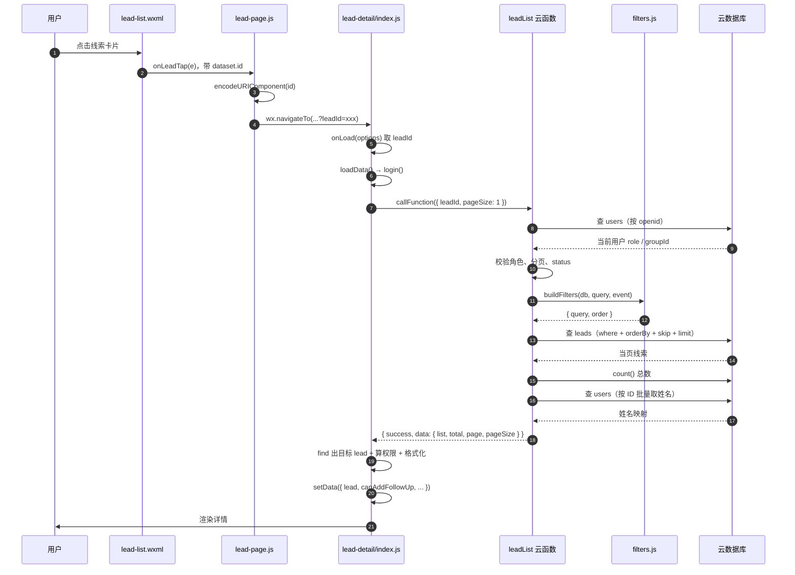

# 15 一次请求的完整旅程

> 前面各章按 API 切开讲，这一章反过来：**跟着一次真实请求，从点击走到数据库，再走回来。**

选的是最典型的一条路径——成员在列表页点一张卡片，详情页显示出数据。这条路上跨了 6 个文件、过了 9 道校验、数据形状变了 6 次。

读完这章，你应该能回答：为什么详情页明明只要一条数据，却调了「列表」接口？为什么返回的 `assignedSalesNames` 是拼好的字符串而不是数组？

## 15.1 全景



注意三件事，后面逐段展开：

1. **前端只传了一个 `leadId`**，没传任何身份信息；
2. **云函数内部发了 4 次数据库查询**，不是一个；
3. **返回的数据不是数据库里的原样**，字段被裁剪、名称被拼接过。

## 15.2 第 0 跳：WXML 把 ID 挂到 dataset 上

```html
<!-- miniprogram/templates/lead-list.wxml:36 -->
<view bindtap="onLeadTap" data-id="{{item._id}}">
```

用户点的可能是卡片里的任何一个子元素（标题、电话、备注），事件会冒泡到这个外层 `<view>`。所以处理函数里必须用 `e.currentTarget.dataset.id`——用 `e.target` 的话，点文字时拿到的是 `<text>` 的 dataset，是空的。

这一跳传出去的是**原始字符串**：数据库生成的 `_id`，形如 `a1b2c3d4e5f6`。

## 15.3 第 1 跳：onLeadTap 拼 URL

```js
// miniprogram/utils/lead-page.js:124
onLeadTap(e) {
  wx.navigateTo({ url: '/pages/lead-detail/index?leadId=' + encodeURIComponent(e.currentTarget.dataset.id) });
}
```

`encodeURIComponent` 在这里其实**不是必需的**——数据库 `_id` 只含字母数字，不含 `&`、`?`、`=`。

那为什么还要加？因为这段代码是「按最坏情况写的」：只要参数来源可能变化（今天是 `_id`，明天可能是用户输入的客户名），编码就是零成本的保险。**养成习惯比每次判断「这次需不需要」更省心。**

这一跳的数据形状：`{ _id: 'a1b2c3d4' }` → 字符串 `'/pages/lead-detail/index?leadId=a1b2c3d4'`。

## 15.4 第 2 跳：onLoad 拆 query

```js
// miniprogram/pages/lead-detail/index.js:23-31
onLoad(options) {
  const { leadId } = options;
  if (!leadId) {
    wx.showToast({ title: '参数错误', icon: 'none' });
    setTimeout(() => wx.navigateBack(), 1500);
    return;
  }
  this.setData({ leadId });
  this.loadData();
}
```

三个细节：

**第一，`options` 里的值全是字符串。** 这里 `leadId` 本来就是字符串，所以不用转换。但同一个项目里 `admin/group-leads` 的 `groupId` 就必须 `Number()`——因为数据库里存的是数字。

**第二，缺参数时不要停在空页面。** 直接 `showToast` + 延时 `navigateBack`，让用户回到列表。如果什么都不做，用户会看到一个永远转圈的详情页。

**第三，`onLoad` 只做「只该做一次」的事。** 加载数据放在 `loadData()`，由 `onLoad` 和 `onShow` 分别调用：

```js
// miniprogram/pages/lead-detail/index.js:34-37
onShow() {
  // 从添加跟进页返回时刷新
  if (this.data.leadId) this.loadData();
}
```

这样从「添加跟进」页返回时，详情页会自动刷新出新的跟进记录。**不需要事件总线，也不需要手动传消息**——靠页面生命周期就能完成同步。

**代价**：`onLoad` 里已经调了一次 `loadData()`，紧接着 `onShow` 又调一次，所以首次进入会**请求两次**。

这是本项目一个真实的小浪费。想修的话有两种办法：在 `onLoad` 里不调，只靠 `onShow`；或者用一个 `this._loaded` 标记跳过首次 `onShow`。前者更简单，但要注意 `onShow` 在 `onLoad` 之后一定会触发（微信保证这个顺序）。

## 15.5 第 3 跳：loadData 的三道前置判断

```js
// miniprogram/pages/lead-detail/index.js:39-41
async loadData() {
  this.setData({ loading: true });
  try {
    const user = await login();
    if (!user) {
      wx.redirectTo({ url: '/pages/login/index' });
      return;
    }
```

**第一道：拿到用户。** `login()` 内部有三层缓存（内存 → 本地存储 → 云函数），这里没传 `forceRefresh`，所以大多数情况是读缓存，很快。

**第二道：没有用户就跳登录。** 用 `redirectTo` 而不是 `navigateTo`——[第 06 章](06-页面路由与参数传递.md) 讲过原因：不能让用户按返回键回到这个打不开的页面。

**第三道（隐式的）：`loading: true` 在最前面。** 这样即使后面抛异常，`finally` 里的 `loading: false` 也能配对。如果写在 `await` 之后，`login()` 抛错时页面会永远停在「加载中」。

## 15.6 第 4 跳：为什么详情页调「列表」接口

```js
// miniprogram/pages/lead-detail/index.js:49-53
const leadRes = await wx.cloud.callFunction({
  name: 'leadList',
  data: { leadId: this.data.leadId, pageSize: 1 }
});
```

这里没有专门的 `leadDetail` 云函数，而是复用 `leadList`，靠 `leadId` 过滤 + `pageSize: 1` 只要一条。

**为什么这么做？** 因为**权限逻辑只有一份**。

如果单独写一个 `leadDetail`，它需要重复实现：查用户、判角色、判团队、判分配关系。这套逻辑在 `leadList` 里已经写好了（而且有测试覆盖）。复制一份的代价是：将来改权限规则，要改两个地方，漏一个就是越权漏洞。

**代价是什么？** 两点：

1. 多返回了 `total`（一条记录的 total 恒为 1，没用）；
2. 前端还要再 `find` 一次：

```js
// miniprogram/pages/lead-detail/index.js:55
const lead = leadRes.result.data.list.find(l => l._id === this.data.leadId);
```

因为 `leadList` 返回的是数组（即使只有一条）。**这个 `find` 看起来多余，但它是一个保险**：如果云函数因为权限过滤掉了这条记录（比如成员被移出协作），`list` 会是空数组，`find` 得到 `undefined`，下一行就能给出正确的提示：

```js
// miniprogram/pages/lead-detail/index.js:56-60
if (!lead) {
  wx.showToast({ title: '线索不存在', icon: 'none' });
  setTimeout(() => wx.navigateBack(), 1500);
  return;
}
```

注意这里提示的是「线索不存在」而不是「无权限」——**这是有意的模糊处理**。如果提示「无权限查看」，等于告诉攻击者「这个 ID 确实存在，只是你看不到」，泄露了信息。用「不存在」统一回应，既保护了数据，也没让正常用户困惑（对他来说，看不到就是不存在）。

## 15.7 第 5 跳：云函数里的 8 个步骤

`leadList` 是整个项目最长的云函数，拆开看是 8 步：

| 步骤 | 代码位置 | 做什么 |
| --- | --- | --- |
| 1 | `index.js:22-31` | 按 openid 查用户，判角色、判团队 |
| 2 | `index.js:33-39` | 校验分页参数 |
| 3 | `index.js:42-62` | 按角色构造基础查询条件 |
| 4 | `index.js:65-74` | 可选的状态筛选（要兼容历史数据） |
| 5 | `index.js:75-79` | 交给 `buildFilters` 加筛选/排序 |
| 6 | `index.js:84-90` | 查当页数据 |
| 7 | `index.js:93` | 查总数（并行不并行都行，这里是串行） |
| 8 | `index.js:96-152` | 批量查姓名，组装返回 |

### 第 3 步：角色决定「看到什么」

```js
// cloudfunctions/leadList/index.js:42-62
if (role === 1) {
  query.groupId = groupId;
} else if (role === 2) {
  query.assignedSalesIds = userId;
  query.groupId = groupId;
} else if (role === 0) {
  if (event.groupId) { /* 校验后按组筛 */ }
} else {
  return { success: false, message: '无权限访问' };
}
```

成员的两个条件必须同时存在：`assignedSalesIds` 保证「只看到分配给自己的」，`groupId` 保证「只看到本团队的」。**前者是业务规则，后者是纵深防御**——万一数据里出现跨团队分配（脏数据），也不会漏。

### 第 4 步：状态筛选为什么这么绕

```js
// cloudfunctions/leadList/index.js:65-74
if (event.status) {
  if (!['NEW', 'CONTACTED', 'QUOTED', 'WON', 'LOST'].includes(event.status)) {
    return { success: false, message: '状态筛选无效' };
  }
  // Historic leads may have status but no lastStatus.
  query = db.command.and([query, db.command.or([
    { lastStatus: event.status },
    { lastStatus: db.command.exists(false), status: event.status }
  ])]);
}
```

看起来只是「按状态筛选」，为什么要用 `and + or` 嵌套？

因为**历史数据只有 `status` 没有 `lastStatus`**。项目某次迭代引入了 `lastStatus`（表示「最近一次跟进后的状态」），旧记录没有这个字段。如果只查 `{ lastStatus: 'NEW' }`，所有老数据都会被漏掉。

所以正确条件其实是：

```
（lastStatus === 目标值）  或者  （lastStatus 不存在 且 status === 目标值）
```

这正是 `db.command.or([...])` 里那两个对象。而外层必须再包一层 `and`，因为要跟已有的 `query`（团队/分配条件）组合——**直接 `Object.assign` 会把 `groupId` 覆盖掉**。

**这个模式值得记住**：给已有数据模型加新字段时，查询条件必须兼容「字段不存在」的旧记录。`db.command.exists(false)` 就是为这个场景存在的。

### 第 8 步：把 ID 变成姓名

数据库里 `leads.assignedSalesIds` 存的是 ID 数组，但界面要显示姓名。做法是**先收集本页所有 ID，一次批量查出来，再在内存里做映射**：

```js
// cloudfunctions/leadList/index.js:96-119
const leadIds = leadsRes.data.map(l => l._id);
const salesIds = new Set();
const anchorIds = new Set();
leadsRes.data.forEach(lead => {
  if (lead.assignedSalesIds && Array.isArray(lead.assignedSalesIds)) {
    lead.assignedSalesIds.forEach(sid => salesIds.add(sid));
  }
  if (lead.createdByAnchorId) {
    anchorIds.add(lead.createdByAnchorId);
  }
});

let salesMap = {};
if (salesIds.size > 0) {
  const salesRes = await db.collection('users')
    .where({ _id: db.command.in(Array.from(salesIds)) })
    .field({ _id: true, name: true })
    .get();
  salesRes.data.forEach(s => { salesMap[s._id] = s.name || '未命名'; });
}
```

三个设计点：

1. **`Set` 去重**。20 条线索可能只涉及 3 个成员，用 `Set` 保证 `in` 查询的数组里没有重复 ID。
2. **`field` 裁剪**。只要 `_id` 和 `name`，不把手机号、openid 带出来。
3. **`size > 0` 才查**。如果本页没有分配成员，跳过这次查询，省一次往返。

**如果不用批量会怎样？** 每条线索查一次用户表，20 条线索就是 20 次查询。这叫 **N+1 查询问题**，是接口变慢最常见的原因。这里的做法把它压到了固定 2 次（成员一次、负责人一次）。

顺带一提：`leadIds` 这个变量在后面的代码里**没有被用到**——是一段遗留的死代码。教程保留它作为提醒：**变量声明了没用，是重构时最容易漏掉的信号。**

## 15.8 第 6 跳：返回值的 6 次变形

同一个「线索」，在这条路上有 6 种不同的形状：

| # | 位置 | 形状 | 说明 |
| --- | --- | --- | --- |
| 1 | WXML `data-id` | `'a1b2c3'` | 纯字符串 |
| 2 | URL query | `'?leadId=a1b2c3'` | 拼进路径 |
| 3 | `onLoad(options)` | `{ leadId: 'a1b2c3' }` | 框架解析出来的对象 |
| 4 | 数据库文档 | 全部字段 + `_id` + 时间戳 | 原始形态，含不对外字段 |
| 5 | 云函数返回 | 15 个字段，`assignedSalesNames` 是 `'张三、李四'` | **裁剪 + 拼接** |
| 6 | `setData` 后的 `lead` | 多 4 个派生字段 | 给渲染用的预格式化值 |

第 5 次变形最值得看：

```js
// cloudfunctions/leadList/index.js:135-152
const list = leadsRes.data.map(lead => ({
  _id: lead._id,
  groupId: lead.groupId,
  phone: lead.phone,
  customerName: lead.customerName || '',
  status: lead.status,
  lastStatus: lead.lastStatus || lead.status || 'NEW',
  remarks: lead.remarks,
  createdAt: lead.createdAt,
  lastFollowUpAt: lead.lastFollowUpAt,
  nextFollowUpAt: lead.nextFollowUpAt || null,
  followUpCount: lead.followUpCount || 0,
  createdByAnchorId: lead.createdByAnchorId,
  createdByName: anchorMap[lead.createdByAnchorId] || '未知',
  assignedSalesIds: lead.assignedSalesIds || [],
  assignedSalesNames: (lead.assignedSalesIds || []).map(sid => salesMap[sid] || '未知').join('、')
}));
```

**这不是「原样返回」，是「按需投影」。** 每个字段都在做三件事之一：

- **兜底**：`customerName || ''`、`followUpCount || 0`、`lastStatus || lead.status || 'NEW'`（三级兜底，兼容只有 `status` 的旧数据）；
- **转换**：`assignedSalesNames` 把 ID 数组拼成中文顿号分隔的字符串，`createdByName` 把 ID 换成姓名；
- **裁剪**：不返回 `openid`、不返回整个 `users` 文档。

**为什么把姓名拼成字符串，而不是返回 `[{id, name}]`？** 因为列表页只用来显示。返回数组的话，WXML 里要写 `wx:for` 或者更复杂的表达式，而 `{{item.assignedSalesNames}}` 一行就够了。

**代价**：如果将来要做「点成员名跳转到他的线索列表」，这个字符串就不够用了——那时得改成返回结构化数组，同时保留一个 `assignedSalesNames` 给显示用。这是「为当前需求优化」的典型取舍。

第 6 次变形发生在前端：

```js
// miniprogram/pages/lead-detail/index.js:86-91
const leadWithTime = {
  ...lead,
  createdAtDate: lead.createdAt ? formatDateOnly(lead.createdAt) : '',
  createdByName: lead.createdByName || '未知',
  nextFollowUpDate: chinaDay(lead.nextFollowUpAt),
  lastStatusText: getStatusText(lead.lastStatus)
};
```

四个派生字段，全是「显示用」的：日期格式化、状态中文化、时区转换。**放在 JS 层而不是 WXML 里算**，原因是这些函数可以被单元测试覆盖（[第 14 章](14-扩展能力清单.md) 14.8 讨论过 WXS 的对比）。

## 15.9 沿途的 9 道校验

这条路上每一道关都可能在拒绝：

| # | 位置 | 校验内容 | 失败后的表现 |
| --- | --- | --- | --- |
| 1 | `lead-detail:24` | `leadId` 非空 | toast「参数错误」+ 返回 |
| 2 | `leadList:23` | 用户存在 | 返回 `success: false` |
| 3 | `leadList:29` | 负责人/成员必须有团队 | toast「请先联系管理员分配团队」 |
| 4 | `leadList:35-39` | 分页参数合法 | toast「分页参数无效」 |
| 5 | `leadList:42-62` | 角色在白名单内 | 「无权限访问」 |
| 6 | `leadList:66` | 状态值在白名单内 | 「状态筛选无效」 |
| 7 | `filters.js:60-80` | 排序、关键词、日期格式 | 抛错 → 被 `catch` 转成 `message` |
| 8 | `lead-detail:56` | 查到线索（含权限过滤后） | toast「线索不存在」+ 返回 |
| 9 | `lead-detail:78-81` | 能否加跟进、能否删除 | 不报错，只控制按钮显隐 |

**第 1~7 道是「拒绝」，第 8 道是「数据层面的拒绝」，第 9 道只是 UI 控制。**

第 9 道特别值得说明：`canAddFollowUp` 和 `canDelete` 只决定按钮显示不显示。用户如果能绕过前端（改内存、直接调云函数），云函数里还有独立的校验（`followUpCreate`、`leadDelete` 各自的入口判断）。**前端判断是体验，云函数判断才是安全**（[第 11 章](11-权限模型与鉴权链路.md) 11.4）。

## 15.10 沿途的类型转换

这条路上有 4 处必须转换类型，每一处都有具体原因：

| 位置 | 转换 | 为什么必须 |
| --- | --- | --- |
| `lead-page.js:124` | `encodeURIComponent(id)` | 防止参数里出现 `&`、`?` 破坏 URL 结构 |
| `lead-detail:72` | `String(id) === String(userId)` | 数据库里 ID 可能存成不同类型，严格相等会漏 |
| `lead-detail:67` | `leadGroupId == userGroupId` | 宽松相等，注释写明「处理类型差异」 |
| `filters.js:16` | `new Date(value + 'T00:00:00+08:00')` | 日期字符串必须显式带时区，否则按 UTC 解析 |

第 2、3 处值得单独说。

```js
// miniprogram/pages/lead-detail/index.js:67
const isSameGroup = leadGroupId == userGroupId; // 使用 == 处理类型差异
```

这里用了 `==` 而不是 `===`。**在别的地方这是坏味道，这里是有意的**：`lead.groupId` 来自数据库（数字），`user.groupId` 来自 `authLogin` 返回（也可能被本地存储转成字符串）。两者值相同但类型不同时，`===` 会判 false，导致「明明是同一团队却看不到数据」。

```js
// miniprogram/pages/lead-detail/index.js:70-72
const userId = user.userId || user._id; // 兼容两种字段名
const isSalesAssigned = userId && Array.isArray(assignedSalesIds) && assignedSalesIds.length > 0 &&
  assignedSalesIds.some(id => String(id) === String(userId));
```

`user.userId || user._id` 是在兼容两种用户对象形状：`authLogin` 返回的用 `userId`，数据库文档用 `_id`。`String(id) === String(userId)` 同理，避免数组里存的是字符串、当前用户是数字。

**这两处都是「历史包袱」的痕迹。** 理想情况下字段名应该统一、类型应该一致，但现实项目里往往做不到——所以防御性转换是必要的。代价是代码变啰嗦，而且**这类转换一旦漏掉一处，就是「偶发」bug**（某些用户能看、某些不能），最难排查。

## 15.11 三个值得追问的设计

### 为什么不用 `Promise.all` 并行两个云函数调用

`loadData` 里先调 `leadList`，再调 `followUpList`，是串行的：

```js
const leadRes = await wx.cloud.callFunction({ name: 'leadList', ... });
// ...处理 leadRes...
const followUpRes = await wx.cloud.callFunction({ name: 'followUpList', ... });
```

理论上可以并行（两者互不依赖）。但这里串行是对的，因为：**如果线索都查不到（权限不足/已删除），就没必要再查跟进记录**。串行省掉了一次无效请求，也避免了「线索 403 但跟进记录正常返回」这种信息泄露。

**判断标准**：两个请求有依赖 → 串行；无依赖且都需要 → 并行。这里的依赖是「业务上的前置条件」，不是数据依赖。

### 为什么 `finally` 里又设了一次 `loading: false`

```js
// miniprogram/pages/lead-detail/index.js:132-138
} catch (error) {
  console.error('加载数据失败:', error);
  wx.showToast({ title: '加载失败', icon: 'none' });
  this.setData({ loading: false });
} finally {
  this.setData({ loading: false });
}
```

`catch` 里已经设过一次，`finally` 里又设一次——**重复了**。功能上无害（`setData` 幂等），但这是典型的「改代码时忘了删旧逻辑」。

干净写法是只留 `finally`：

```js
} catch (error) {
  console.error('加载数据失败:', error);
  wx.showToast({ title: '加载失败', icon: 'none' });
} finally {
  this.setData({ loading: false });
}
```

**为什么保留在教程里而不是修掉？** 因为它是一个真实的例子，说明「`finally` 是保证清理逻辑只写一次的工具」。看到重复的清理代码，就该想到用 `finally` 收敛。

### 为什么详情页不复用列表页已经拿到的数据

列表页明明已经有这条线索的完整数据了，为什么详情页还要再查一次？

因为**列表页的数据可能已经过期**。用户从列表点进详情，中间可能隔了几分钟；或者从详情页返回列表、再点进来，这期间的跟进记录已经变了。重新查一次，保证看到的是最新状态。

**代价**：多一次网络往返（约 100~300ms）。**收益**：数据一致性。对 CRM 这种「状态频繁变化」的场景，一致性优先。

如果要做「秒开详情页」，可以先用列表页的数据渲染（乐观显示），同时后台请求最新数据，回来再覆盖。这叫 **stale-while-revalidate**，是更高级的优化——本项目没做，因为数据量小、网络不慢，收益不明显。

## 15.12 练习

1. **数一数请求**：在 `lead-detail/index.js` 的 `loadData` 开头加 `console.log('loadData called')`，然后从列表点进详情，数一下控制台打印了几次。解释为什么是 2 次而不是 1 次。
2. **修掉重复请求**：按 15.4 节的两个方案之一，把首次进入的双请求改成单请求，确认从跟进页返回时仍会刷新。
3. **加一个字段**：让 `leadList` 额外返回「该线索的跟进次数是否为 0」这个布尔值。想清楚这个逻辑该放在云函数（省前端计算）还是前端（省传输）。两边都试一遍，对比代码量。
4. **找 N+1**：在 `leadList` 里找出「如果改成循环查姓名，会多几次查询」，算出 20 条线索时的查询总数。
5. **读死代码**：找出 `leadList` 里声明了但没用的变量，判断它是「遗留」还是「未来会用」。

---

上一篇：[14 本项目没用到但值得知道的能力](14-扩展能力清单.md) · 下一篇：[16 源码精读：buildFilters 的 86 行](16-源码精读-buildFilters.md)
